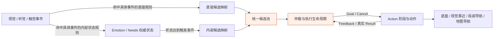

# 两类行为来源与统一仲裁

2026-10-13 确认：业务行为分为**感知直驱式**和**内部触发式（被动式）**。
两类指行为的直接触发路径，不是把视觉、听觉、触觉模块整体归入直驱。
每个感知模块中，部分事件直接产生候选，部分事件只影响情绪；是否同时走两条路径，
由具体事件规则明确。情绪达到触发条件后产生内部候选，生理、心理需求也属于内部触发。
两类候选共用候选池、优先级仲裁、抢占/取消和 Action 执行。

“直驱”表示无需先由内部状态达到触发条件，不表示传感器可以直接控制底盘。
“内部触发”也不表示始终低优先级：低电量等具体事件仍使用已有安全优先级。
来源、优先级、动作模板、交互目标、执行后端是不同维度。

## 数据流与职责

感知模块生产事实、命令及关联信息；Emotion/Needs 是内部状态的权威；BT 决定
启动哪个行为以及何时抢占；Action 负责执行阶段、外部能力调用和真实终态。
图中两条输入边表示按事件规则选择消费，不表示每个感知事件都广播成两个行为。
当前 BT 与内部状态模块分别消费已有 Topic 并按各自规则处理，没有新增中央路由服务。
触觉到 Emotion 的订阅和事件处理继续保留；第四批已接入 touch_direct ROS 消费入口，
按用户授权预设摸头、摸耳、碰鼻三类直驱映射。传感器驱动与实物采集仍待硬件。见 [触觉契约](../../interfaces/application/tactile/README.md)。
三类靠近的几何转换和导航调用仍按 [靠近场景](../development/scenarios/CALLER_APPROACH.md)
与此前架构设计逐步接入，不因本次来源分类而宣称已全部打通。

## 事件路由与行为来源是两层概念

| 具体事件的规则 | 直接产生行为候选 | 更新情绪 | 后续内部行为 |
| --- | --- | --- | --- |
| 仅直驱 | 命中直驱映射与校验后产生 | 此事件没有对应情绪规则 | 不因该事件直接产生 |
| 仅影响情绪 | 不产生直驱候选 | 按情绪规则更新状态 | 达到触发条件后才可能产生 |
| 两者兼有 | 独立产生直驱候选 | 独立更新情绪状态 | 后续候选仍按内部状态规则产生 |

未命中这两类规则的输入可能只更新观测、会话或被忽略，不自动强制归类。
影响情绪不等于立即触发行为；内部情绪行为即使最初由感知刺激引起，仍归内部触发。
双路径需要逐事件说明即时反应与后续表达的关系，不默认双发，也不自动禁止合法的后续表达。
现有候选去重、冷却和仲裁继续适用；本次没有新增跨路径因果去重协议。

当前消费侧配置示例（不代表传感器或模型已完成端到端验收）：

- `EVT_VOICE_COMMAND_SIT` 在 BT 的 `audio_direct` 映射中，按对应协议校验后产生直驱候选。
- `EVT_VOICE_COMFORT` 有情绪规则，没有同名 BT 直驱映射；不要和 `EVT_VOICE_COMMAND_COMFORT_*` 混用。
- `EVT_TACTILE_HEAD_PET` 同时有 touch_direct 预设和 Emotion 规则；前者可立即生成候选，后者更新内部状态。
- `EVT_VISION_FALL` 同时有 `visual_direct` 与情绪规则；直驱候选和由内部状态后续触发的候选分别归属。

直驱映射见 `modules/behavior/config/event_intent_map.yaml`，情绪规则见
`modules/emotion/configs/emotions.yaml:eventRules`，消费入口见
`modules/emotion/marsdog_ros2/emotion_engine_node.py`。新功能在功能规格中逐事件列出两侧规则、
前置条件和预期候选，避免把“传感器来源”当成“行为触发方式”。

## 两类来源如何落到现有代码

不新增 ROS 字段或重写既有 `source`。BT 的纯组件
`bionic_dog_bt.drive_policy.resolve_drive(params, need_type)` 根据已有字段派生策略。
它解析的是已生成行为候选的触发归属，不负责把原始感知事件分类或路由。

| 来源 | 派生 drive | 状态权威 | 候选有效性 |
| --- | --- | --- | --- |
| audio_direct / audio_reaction / audio_session | perception_direct | 无内部状态所有权 | 原有 TTL、会话、目标与显式前置条件 |
| visual_direct | perception_direct | 无内部状态所有权 | 原有事件校验、TTL、目标与场景条件 |
| touch_direct | perception_direct | 无内部状态所有权 | 白名单 STARTED 事件、时间戳、TTL、去重和单调冷却 |
| emotion | internal_state | Emotion | 派发前核对对应 emotion.triggered |
| need | internal_state | Needs | 派发前核对对应 demand.triggered |

已知 `source` 优先于旧 `need_type`。缺少或尚未登记的来源仍兼容旧
`need_type=emotional/physiological/physiological_urgent/psychological`。
系统、空闲及未知来源不会被强行归入一类业务驱动，继续走原规则。
这些是兼容与基础调度入口，不增加第三类业务来源。

`source_emotion=Joy` 可以仅表示直驱行为使用愉悦表达样式；行为叫
`expressJoyAlone`、处于 Lv5，也不能据此认定它由内部 Joy 状态拥有。
同一个动作模板可以被两类来源复用。新增来源需登记到本模块策略并补生产/消费测试，
不能仅靠事件名称前缀、一个新的 `behavior_drive` 参数或行为名改变归属。

## 仲裁、中断和恢复

| 阶段 | 两类候选共用的规则 | 按来源区分的规则 |
| --- | --- | --- |
| 入队 | 行为名排队/在途去重、TTL、冷却 | 保留原 source、interaction/event/target 关联 |
| 选择 | 原 priority_level、语义、模态及细节排序 | 不增加“直驱天然高于内部”的总开关 |
| 派发前 | 运行时与树节点继续校验 | 内部候选读取权威 triggered；直驱复用情绪模板也不依赖内部情绪触发 |
| 目标解析 | 已解析目标按原规则传入 Action | 仅内部情绪的未解析旧入口执行人物查询，不覆盖直驱目标 |
| 抢占 | 原 interrupt_policy、safe_to_interrupt 和 Goal 状态 | 直驱与内部候选均可按具体优先级竞争 |
| Cancel ACK | 原 Goal 继续占用，替代行为等待 | 两类都不能把 ACK 当作停车或结束证明 |
| 真实终态 | 释放原占用，消费原结果，后续 tick 才可派发替代行为 | 仅内部情绪行为计入情绪续演次数并触发续演调度 |
| 状态恢复 | 不因清队列伪造正在执行行为的终态 | 清理相应内部候选；保留携带同名情绪/需求元数据的直驱候选 |

内部状态恢复本批只影响尚未派发候选。正在执行的行为沿用既有结束、超时和取消策略，
不会因为 `triggered=false` 自动停止。是否需要“恢复即取消”必须在具体功能规格中定义。
未知 Action 终态继续保留占用并进入既有恢复流程；本批未增加执行端对账或物理停车协议。

## 本批代码边界

- `bionic_dog_bt/drive_policy.py`：来源与状态归属的唯一解析规则。
- `bionic_dog_bt/relevance.py`：树节点和兼容入口共用的候选相关性检查。
- `conditions.py`、`actions.py`：派发前有效性及未解析目标处理。
- `candidate_pool.py`：按真正的状态归属清理候选，保留在途生命周期。
- `ros_node.py`：内部情绪续演只消费内部情绪行为的启动/终态。
- `decision_trace.py`：派生记录 `behavior_drive/state_domain/legacy_drive`，不写入 Goal 参数。

没有跨模块私有 import，没有新增公共业务 common，保留 ROS 名称与需求结算公式。
第四批统一了多处排序实现并新增触觉配置；现有主／语义／模态优先次序不变，详见 [子优先级契约](PRIORITY_CONTRACT.md)。
两类来源不会各自维护一套相互独立的执行状态机。

## 新功能的最小验收

1. 逐事件列出直驱规则与情绪影响规则；两者兼有时分别说明即时反应、后续状态触发和去重预期。
   对实际产生的行为指定感知直驱或内部触发、具体 source 与状态权威，单独指定优先级和中断策略。
2. 同模板分别从两类来源产生候选，证明内部状态只约束内部候选。
3. 覆盖恢复清队列、目标不被覆盖、直驱不参与内部续演、重复事件和过期输入。
4. 验证较低优先级直驱不能越过当前行为，较高优先级内部需求仍能按规则请求抢占。
5. 验证 Cancel ACK 后不派发替代行为，真实 Result 才释放占用。

对应回归：`tests/test_behavior_drive_policy.py`、`tests/test_behavior_drive_integration.py`。
门禁按 [开发流程](../development/WORKFLOW.md) 执行；软件替身、真实 ROS 传输和实机验收分别记录。
