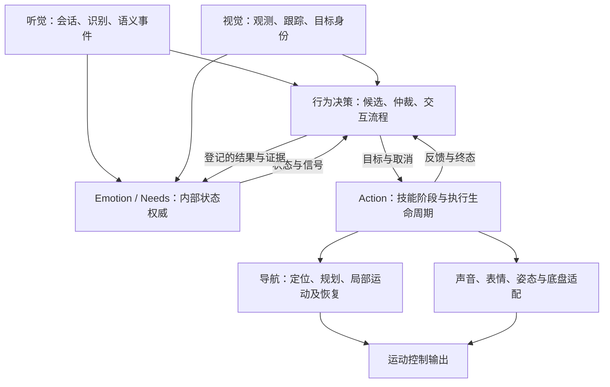

# MarsDog 当前系统架构基线

本基线用于五人团队确定功能归属、接口边界和交付范围。沿用单主仓、独立 Python 环境与 ROS 2 通信；新增功能按跨模块场景交付。2026-10-12 核对的源码基点为 `c21c3bf`，工作区分支为 `codex/reusable-local-motion`，包含尚未提交的板端导航及局部运动修改。该工作区状态不是发布标签。

迁移与兼容性重构的历史结论保留在 [迁移记录](../migration/STATUS.md) 和 [兼容性重构](COMPATIBILITY_REFACTOR.md)。本页定义当前开发入口；精确事件、字段及取消语义仍以 [应用协议](../../interfaces/application/README.md)、接口登记和相应实现为准。

## 领域职责与数据流

图中的运动输出表示现有多条能力链路。全系统的控制权交接与唯一命令出口仍需完善，不能从该图推断已有全局仲裁器。

| 领域 | 权威内容 | 对外提供 | 归属限制 |
| --- | --- | --- | --- |
| Voice | 音频处理、唤醒、识别、声纹与语音会话 | 音频事件、语音任务与会话服务 | 输出语义和授权信息；身体行为由 BT 仲裁 |
| Vision | 检测、跟踪、目标身份和视觉快照 | 视觉事件、目标查询 | 不把图像观测直接当作地图导航目标 |
| Emotion / Needs | 内部数值、阈值、恢复与结果结算 | 权威状态快照及变化信号 | BT 的镜像不成为第二个状态生产者 |
| Behavior | 候选池、相关性、抢占与跨能力交互 | ExecuteBehavior 目标、取消、结果事件 | 不导入其他模块的私有实现 |
| Action | 技能阶段、资源占用、适配器调用和执行终态 | 进度、安全中断反馈及结果证据 | 不在动作适配器中重新实现全局行为优先级 |
| Navigation | 地图、定位、TF、规划、避障、局部运动与恢复 | 已登记服务、Action、运动反馈 | 任务内部恢复归导航；任务选择归应用 BT |
| 平台工程 | 环境、构建、配置装配、日志和验证 | 开发与交付工具 | 不承载在线业务决策或全局业务状态 |

各目录和兼任责任见 [五人责任表](../OWNERSHIP.md)。Nav2 内部行为树负责导航任务内部执行，应用 BT 负责机器人任务选择。Action 在两者之间管理技能及执行实例。

## 状态和生命周期约定

1. 区分 Event、Intent、Candidate、Behavior、Goal、Stage 和 Unit；同一行为可以产生多个不同 Goal。
2. Voice 持有语音会话状态；BT 持有跨能力交互流程状态。两者通过现有 hold、renew、release 和会话 ID 协调。
3. Vision 持有目标身份和 epoch；消费者验证新鲜度、跟踪状态和身份关联，不能用“主人”字符串代替目标引用。
4. BT 持有待执行与当前 Goal；Action 持有实际执行生命周期。取消 ACK 不释放当前 Goal，必须等待终态或进入明确的恢复约束。
5. 排队 TTL、执行 timeout、保活 lease、冷却 cooldown 和停止确认期限分别配置、分别测试。
6. 状态结算依照已有行为映射与证据规则。取消和失败不伪装成成功；已有中断状态变化仍保留。`go_home` 不产生 Energy 结算，模拟电量不能证明充电。
7. 应用 `emergency_stop` 的优先级不等于物理急停时延保证。设备侧停机约束需由实际接口和实机证据确认。

## 组件演进约定

现有兼容性提取保留了向函数传入节点 `self` 的方式，例如 Voice 的 speech pipeline、BT 的 voice engagement、Action 的 goal execution。它减少了迁移风险，但节点的私有状态仍是这些函数的隐式依赖。

下一步按变更热点逐个提取明确组件：核心逻辑持有本领域状态，通过构造参数或小型端口取得时钟、日志、感知查询、执行客户端等依赖；ROS 节点负责参数、订阅、服务和生命周期装配。每次只迁移一项状态所有权，保留原入口代理和同一份运行状态，避免同时维护两套锁或会话。

先以唤醒交互协调、人物接近适配为样本，再推广。验证标准是能独立构造、测试取消和迟到回调，以及明确依赖，不以文件行数或统一目录层数验收。

## 当前能力与已知缺口

完整配置状态见 [能力基线](CAPABILITY_BASELINE.md)，代表链路见 [叫过来场景](../development/scenarios/CALLER_APPROACH.md)。

| 编号 | 当前事实 | 下一步责任 |
| --- | --- | --- |
| GAP-01 | 125 条声明路由中有 49 条引用缺失的 Action 模板；兼容检查允许这些已登记历史缺口 | BT 与 Action 按产品优先级逐项排入任务，不批量伪造动作 |
| GAP-02 | Vision `locate_person_once` 返回视觉目标；PersonNavApproachAdapter 对此返回 `visual_target_only_no_navigation_geometry` | Action 牵头、Vision 与导航协作，补齐受验证的几何接入设计和测试 |
| GAP-03 | Nav2、UWB 和 Action 有局部保护，仍需部署层保证运动控制权唯一 | Action 与导航共同明确控制权交接和停止确认边界 |
| GAP-04 | 部分流程组件依赖整个 ROS 节点上下文；配置路由和特殊场景分支并存 | BT、Voice、Action 按代表场景渐进拆分 |
| GAP-05 | ROS 集成工作流采用手动触发；本轮没有核查远端 runner 与分支保护 | 集成负责人核对实际 CI，建立每版交付证据 |

兼容门禁通过表示已登记边界未退化；不表示所有产品能力或实机运动均已验收。旧接口需要演进时，先记录产品语义与生产消费双方迁移方式，不能通过刷新冻结基线掩盖变化。

## 环境与交付基线

| 环境 | 用途与入口 | 验收边界 |
| --- | --- | --- |
| Ubuntu 22.04 / Python 3.10 / Humble，原 WSL2 CPU 路径 | [快速开始](../development/QUICKSTART.md)、[本机组合](../LOCAL_LITE3_CPU.md) | 感知、设备替身与真实算法应分别标明 |
| 当前 RK3588 ARM64 板端 | [导航构建说明](../../robotics/ros2/NAVIGATION_BUILD.md) | 已有板端构建记录；不自动继承 WSL 二进制或全部验收结论 |
| 可选通用局部运动 | [robot_local_motion](../../robotics/ros2/src/robot_local_motion/README.md) | 当前默认关闭；独立 overlay，不替换旧默认路由 |
| 机器人型号配置 | [机器人 profiles](../../robotics/ros2/ROBOT_PROFILES.md) | 配置存在不证明对应设备、标定、控制协议已联调 |

每次发布记录 Git commit、dirty 补丁或拒绝 dirty 发布、模块锁、接口版本、配置哈希、模型版本、机器人型号、实际 overlay 和测试证据。发布包必须可还原；开发中的 dirty 工作区只能作为研发快照。

执行顺序见 [重构路线](REFACTOR_ROADMAP.md)，开发规则见 [工程规范](../development/ENGINEERING_STANDARD.md)，本轮验证见 [落地记录](../../validation/architecture-baseline/README.md)。
