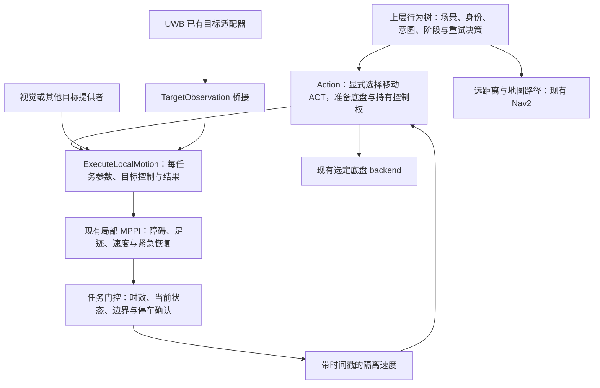

# MarsDogPlatform 通用局部运动接口与仿生场景参数指南

更新日期：2026-10-14。源码基于 `/home/marsdog/MarsDogPlatform`，分支 `codex/reusable-local-motion`。本指南对应新增的 `robot_local_motion` 包与 Action 的可选适配器。编译、纯逻辑测试和模拟 ROS 通信测试与实机验收分别记录，不能将模拟通过当作实机运动通过。

## 1. 已实现的分层

旧 UWB 三个 Action、原有导航入口 `nav.launch.py`、旧动作路由和参数默认值继续保留。新增接口默认关闭，只有上层明确选择时才使用。原有 MPPI 的碰撞检查、足迹、实测速度反馈与紧急恢复算法继续复用。



行为树判断“现在是否应该捡飞盘、跟主人、停止玩耍、返回充电”，并决定目标、参数和失败后的下一步。局部任务仍判断目标是否过期、是否到达、速度是否超限、碰撞风险与停车是否确认，这些实时判断不能依赖行为树的低频调度。

固定目标和持续目标是不同语义。`move` 的相对目标在任务起步时固定到 `odom`，不会每一帧随机器人移动。`follow` 则持续使用同一身份的最新观测。相机光学坐标目标先通过已有标定 TF 做完整三维变换，再投影到地面平面；没有 TF 时不会猜测外参。

## 2. 六种任务模式

| mode | 输入 | 完成条件 | 典型用途 |
| --- | --- | --- | --- |
| `move` | 固定 PoseStamped | 位置到达；可选最终朝向；保持后确认停车 | 短距离移步、飞盘附近的局部终点、回窝最后一段 |
| `approach` | 有身份的目标观测 | 达到指定接近距离；可选面向目标；确认停车 | 到主人附近、接近飞盘、接近声源的最后一段 |
| `follow` | 持续目标观测 | 指定时长，或明确设置保持距离即完成；也可取消 | 陪走、保持距离、短时间黏着主人 |
| `orbit` | 持续目标观测 | 指定半径、方向和圈数；完成后确认停车 | 绕主人、小范围嬉戏、绕物观察 |
| `explore` | 初始位置、固定中心或持续目标中心 | 完成目标数量或探索时长；确认停车 | 附近探索、限定方向巡看、主人附近活动 |
| `turn` | 固定 PoseStamped 的 yaw | 朝向到达并保持；确认停车 | 看向某方向、观察前转身 |

任务默认有总超时；飞盘独立入口允许 approach 显式取消总时限（见末节），单次仍只接受一个任务。新 Goal 不会自动抢占旧 Goal；行为树先取消并等待旧任务终态，再提交下一项。

`approach`/`follow` 只在目标较远时前进；目标进入近距离区间时停住，可转向面对目标。它们不自动倒退去恢复距离。上述为普通目标追踪语义；飞盘独立部署另外允许原规划器执行明确的紧急后退脱困。需要主动远离、让路或后撤时，上层生成新的安全 `move` 目标；普通移动的倒车能力尚未新增，紧急倒退仍属于原有 MPPI 恢复机制。

## 3. 公共 ROS 接口

| 名称 | 类型 | 含义 |
| --- | --- | --- |
| `/robot_local_motion/execute` | `robot_local_motion/action/ExecuteLocalMotion` | 六种局部任务 |
| `/robot_local_motion/target` | `robot_local_motion/msg/TargetObservation` | UWB、视觉等目标来源共用的观测 |
| `/robot_local_motion/command` | `geometry_msgs/msg/TwistStamped` | Action 底盘桥消费的隔离速度 |
| `/robot_local_motion/cmd_vel` | `geometry_msgs/msg/Twist` | 默认隔离输出，便于独立接入/观测 |
| `/robot_local_motion/release_recovery` | `robot_local_motion/srv/ReleaseRecovery` | 明确请求解除局部服务的恢复锁 |
| `/action/local_motion_release_recovery` | 同上 | 同时处理 Action 侧控制权与底盘停车确认 |

Action Goal 包含 `mode`、`goal`、`target_id`、`target_source`、`parameters_json`。固定 `goal.header.frame_id` 可为 `odom`、当前 `base_frame`，或具有有效 TF 的地图 frame。固定目标要求单位四元数，z 在地面平面附近。`base_frame` 目标的 x/y/yaw 相对于起步时的机器人姿态；其他 frame 通过 Goal 指定时间的 TF 转换，零时间表示最新 TF。

移动目标观测必须携带原始观测时间、frame、`target_id`、`source`、递增 `sequence`、有限坐标、`confidence` 与 `valid`。服务按 `(source, target_id)` 取目标，不自动换成附近另一个人。无效观测会使该目标进入丢失状态，重复、过期、未来时间戳与序号回放会被拒绝。生产者重启应保持序号递增或更换 source；UWB 桥使用时间种子避免普通重启把序号归零。UWB 桥的 confidence=1 表示传输有效，不能解释为 UWB 测距精度为 100%。

结果返回 `outcome`、`message`、`stop_confirmed`、`final_pose`、`effective_parameters_json`；后者包含真正应用的 `effective_planner`，便于上层记录与复现。反馈提供状态、距离、进度、耗时和当前位姿。

## 4. 最小调用示例

先加载本次隔离安装环境：

```bash
source /home/marsdog/MarsDogPlatform/out/rk3588-local-motion/use-local-motion.sh
```

独立局部运动：已有里程计、TF 和 `/local_depth_observation` 时，显式启用服务，速度仍输出到隔离话题：

```bash
ros2 launch robot_local_motion local_motion.launch.py enable_motion:=true
```

相机驱动已经提供 D435i 校正双目时，可让新入口同时启动已有双目障碍投影：

```bash
ros2 launch robot_local_motion local_motion.launch.py \
  enable_motion:=true start_obstacle_projection:=true
```

相机驱动、底盘里程计、已标定 TF 和 UWB 厂家驱动由现有部署提供。新 launch 不启动底盘或厂家串口驱动。若 UWB 原始数据 `/libAoa_robot_publisher` 已有发布者，可以再加 `start_uwb_adapter:=true start_uwb_bridge:=true`；如果已有 `/uwb/target_point`，只启动桥即可。

发一个相对起步位置向前 1 m、侧向 0.3 m 的目标：

```bash
ros2 action send_goal /robot_local_motion/execute \
  robot_local_motion/action/ExecuteLocalMotion \
  '{mode: move, goal: {header: {frame_id: base_footprint}, pose: {position: {x: 1.0, y: 0.3, z: 0.0}, orientation: {w: 1.0}}}, parameters_json: "{\"max_linear_speed\":0.3,\"position_tolerance_m\":0.12,\"require_final_yaw\":true,\"timeout_sec\":20}"}' \
  --feedback
```

到主人约 0.7 m 处：

```bash
ros2 action send_goal /robot_local_motion/execute \
  robot_local_motion/action/ExecuteLocalMotion \
  '{mode: approach, target_id: owner, target_source: uwb, parameters_json: "{\"desired_distance_m\":0.7,\"max_linear_speed\":0.3,\"timeout_sec\":25}"}' \
  --feedback
```

独立接到实际底盘时才明确改 `cmd_vel_topic`。通过 Action 集成时保持隔离输出，由 Action 的现有底盘 backend 转发带时间戳速度；不要同时把服务的 Twist 输出也接到底盘。

## 5. 从现有 Action/行为树调用

`/home/marsdog/MarsDogPlatform/modules/action/config/local_motion.yaml` 中 `enabled` 默认 `false`。启用后，只有 `params_json.local_motion.unit_id` 与正在执行的移动 ACT 一致，才使用新适配器。请求这个接口但未启用适配器时会失败，不会静默回到旧 UWB 控制。

现有 `follow_owner` 行为可以传入：

```json
{
  "local_motion": {
    "unit_id": "ACT_INTERACT_FOLLOW_OWNER",
    "mode": "follow",
    "target_id": "owner",
    "target_source": "uwb",
    "parameters": {
      "desired_distance_m": 1.2,
      "distance_deadband_m": 0.12,
      "distance_reengage_m": 0.25,
      "max_linear_speed": 0.4,
      "duration_sec": 8.0,
      "timeout_sec": 12.0,
      "lost_target_policy": "pause",
      "lost_target_timeout_sec": 2.0,
      "planner": {"weight_obstacle": 4.0, "enable_emergency_reverse": false}
    }
  }
}
```

上层仍向 `/action/execute_behavior` 发送原有 `marsdog_interfaces/action/ExecuteBehavior` Goal，`behavior_name=follow_owner`，上述对象序列化到 `params_json`。原来的 Goal ID、优先级和超时字段继续使用原协议。实际任务预算取场景参数、ACT/Stage 预算与外层行为剩余时间的最小值。不能用内部较大 timeout 越过外层行为预算。

带 `local_motion` 的请求会先校验动作是否属于当前模板与启用清单；即使外层 timeout=0，也走有内部任务预算的通用 Stage，不会被旧无限跟随通道绕过。参数对象存在但格式错误、动作不匹配或适配器未启用时，整个请求明确失败。

默认可选择的移动 ACT：`ACT_INTERACT_FOLLOW_OWNER`、`ACT_INTERACT_APPROACH_OWNER`、`ACT_INTERACT_APPROACH_OWNER_CLOSER`、`ACT_INTERACT_RETURN_OWNER`、`ACT_APPROACH_VISUAL_TARGET`、`ACT_UWB_RANDOM_ROAM`、`ACT_NAV_WALK_RANDOM`、`ACT_CIRCLE_AROUND`。这些 ACT 还必须出现在所选行为模板中。没有在 `allowed_units` 中启用的 ACT 会拒绝；抓取、放下、姿态等动作不能重定向成局部移动并冒充完成。

使用新局部链路时，部署层不要同时启动旧 UWB 行为控制器或让 Nav2/遥控输出覆盖同一底盘。新服务检查其输出话题的其他发布者，但这不能代替整个系统的速度仲裁器。Action 桥模式只由选定的现有 backend 下发最终底盘指令；恢复锁会阻止后续 Stage 执行。

Action 桥要求 backend 实现 `prepare_navigation`、`publish_velocity`、`finish_navigation` 三个端口，以保留准备和停车确认。当前 Lite3 backend 满足此协议；现有 GO2 Sport backend 尚无完整的准备/结算端口，不会因此被标成可执行。GO2 或灵猫可以通过公共 Action 接到它们已有的、具有控制权和停车确认能力的 Twist 消费链；其 SDK 桥接和实机参数仍需分别验证。

## 6. 参数规则

`parameters_json` 是版本 1 的 JSON 对象；`schema_version` 可省略，提供时必须是整数 1。参数区分大小写，拒绝未知键、重复键、NaN、Infinity、错误类型、超范围值和不适用于当前 mode 的专用参数。最多 16 KiB。每个任务创建自己的参数副本；下一任务恢复 MPPI 的启动基线后再应用新的覆盖，避免场景之间相互污染。

目前开放 51 个任务效果/策略参数与 24 个 MPPI 覆盖参数，共 75 个；此外还有目标身份、来源、位姿和版本字段。默认值、允许范围和 mode 专属字段的机器可读定义在：

`/home/marsdog/MarsDogPlatform/robotics/ros2/src/robot_local_motion/config/parameter_schema.json`

下面的表解释使用效果；准确范围以该文件与部署限制共同约束。planner 未显式提供的值来自已有 `local_velocity_planner.yaml`；不是重新填一套算法默认值。

### 通用控制、到达与预算

| 参数 | 默认 | 作用与约束 |
| --- | --- | --- |
| `timeout_sec` | 60 s | 普通任务总预算 0.1–3600 s，并受上层预算限制；仅部署开启 allow_unbounded_approach 时 approach 可用 0 取消总时限 |
| `duration_sec` | 0 | 只用于 follow/explore；0 表示按其他完成条件运行；不能超过总预算 |
| `max_linear_speed` | 0.5 m/s | 每任务线速度上限，不能超过部署上限；当前 Lite3 非零运行至少 0.25 m/s |
| `max_angular_speed` | 1.2 rad/s | 每任务角速度上限，同时限制 MPPI 规划输出 |
| `linear_gain` | 0.6 | 距离误差到名义前进速度的增益，0.01–5 |
| `angular_gain` | 1.0 | 朝向误差到名义角速度的增益，0.01–5 |
| `heading_slowdown_start` | 0.3 rad | 朝向偏差超过此值时降低前进速度 |
| `heading_stop_angle` | 1.4 rad | 偏差达到此值时先转向；必须大于减速起点 |
| `position_tolerance_m` | 0.15 m | move/explore 的目标容差，0.02–1 m；小值不等于底盘实测精度提高 |
| `yaw_tolerance_rad` | 0.08 rad | 转向/最终朝向容差与目标面向死区，0.01–1 rad |
| `require_final_yaw` | false | move 到达位置后，还要对齐 Goal yaw |
| `arrival_hold_sec` | 0.4 s | 到达条件连续保持时间，0–10 s；之后仍须独立确认停车 |
| `max_distance_travelled_m` | 0 | 总行走里程预算；0 不额外限制，达到时返回 DISTANCE_LIMIT |
| `startup_timeout_sec` | 4 s | 等待新鲜传感器、停车与规划器配置的起步预算 |
| `input_recovery_timeout_sec` | 3 s | 里程计/障碍断流立即停止；超过恢复等待时间失败 |
| `blocked_timeout_sec` | 3 s | 障碍阻塞诊断持续时间阈值，0.1–30 s |
| `blocked_policy` | abort | abort 失败；wait 零速等待至任务总超时；resample 仅 explore，有限次数重选 |
| `progress_window_sec` | 5 s | move/approach/explore 静态目标无进展窗口，0.5–60 s |
| `progress_distance_m` | 0.1 m | 认定有效靠近的最小距离改善，0.01–1 m |

turn 不产生普通线速度，但底层规划器的线速度执行区间仍由部署确定。当前 Lite3 不支持把行走效果设为 0.1 m/s：该请求会被拒绝；可用到达停留和上层动作节奏实现较慢的行为观感，不能假设低于底盘死区的速度会执行。

### 接近、持续跟随与目标质量

| 参数 | 默认 | 作用与约束 |
| --- | --- | --- |
| `desired_distance_m` | 1 m | approach/follow 的保持距离；0.5–3 m，且不小于部署最低接近距离 |
| `distance_deadband_m` | 0.08 m | 进入 HOLDING 的距离余量 |
| `distance_reengage_m` | 0.15 m | HOLDING 后重新追随的余量；不得小于 deadband，减少临界来回启停 |
| `face_target_when_holding` | true | 到达保持距离时仍转向面向目标 |
| `complete_when_holding` | false | follow 达到保持距离并保持后即完成；false 持续跟随到时长/取消 |
| `lock_target_position` | false | approach/follow/orbit 冻结第一次有效目标位置；仍要求目标流新鲜 |
| `target_offset_x_m` / `target_offset_y_m` | 0 m | 在 odom 平面给目标点加偏移，范围各为 ±3 m；不是目标人的身体朝向坐标 |
| `target_max_age_sec` | 0.5 s | 当前目标允许的最大原始观测年龄，0.02–2 s |
| `target_min_confidence` | 0 | 目标质量门槛，0–1；含义由目标提供者定义 |
| `lost_target_policy` | pause | pause 立即停住并等待；abort 立即结束并确认停车 |
| `lost_target_timeout_sec` | 3 s | pause 最长等待时间，0–30 s；不会沿最后速度盲走 |

目标必须位于本地有效距离内；当前最大距离为 3 m。观测丢失会打断到达保持计时。固定目标过远和移动目标超范围均有明确失败结果，交给上层使用 Nav2 或重新获取目标。

### 环绕、探索与活动范围

| 参数 | 默认 | 作用与约束 |
| --- | --- | --- |
| `orbit_radius_m` | 1 m | orbit 的环绕半径，0.5–3 m，并遵守部署接近限制 |
| `orbit_direction` | +1 | +1 逆时针，-1 顺时针；不接受 0 |
| `orbit_turns` | 1 | 0.05–10 圈，例如 0.5 半圈；可被总超时终止 |
| `orbit_lead_angle_rad` | 0.35 rad | 在圆周上前瞻局部目标的角度，0.05–1 rad |
| `orbit_capture_tolerance_m` | 0.1 m | 环绕半径进入容差，0.02–0.5 m |
| `lock_orbit_center` | false | true 固定第一次目标中心；false 随目标中心更新 |
| `center_mode` | initial_pose | 探索采样/活动边界中心：initial_pose、goal、target；target 需要有效身份观测 |
| `min_radius_m` / `max_radius_m` | 0.5 / 2 m | explore 环带采样范围，min 必须小于 max，max 不超过本地距离限制 |
| `sector_center_rad` | 0 rad | explore 扇区中心角，±π |
| `sector_width_rad` | 2π | 扇区宽度，0.05–2π |
| `sector_reference` | initial_heading | 扇区按起步机器人朝向，或设 odom 按世界方向采样 |
| `goal_count` | 1 | explore 完成的目标个数，1–100 |
| `goal_pause_sec` | 0 s | 两次探索目标之间的停留，0–30 s |
| `random_seed` | 0 | explore 随机种子；0 使用随机种子，非零便于复现 |
| `max_sample_attempts` | 50 | 每次采样最多尝试次数，1–100；没有合适点返回 NO_VALID_GOAL |
| `goal_obstacle_clearance_m` | 0.7 m | 探索候选点到障碍点的距离；同时不小于机器人外接圆半径 |
| `max_retries` | 2 | explore resample 策略的累计重选次数，0–20 |
| `boundary_radius_m` | 0 | 活动圆形边界半径；0 关闭；设置后计入机器人外接半径与预测运动 |
| `boundary_prediction_sec` | 1 s | 对输出速度轨迹做边界检查的预测时域，0.1–3 s |

探索是局部已观测障碍范围内的随机目标任务，不能声称探索到的是全局未知自由空间。扇区与圆形边界是活动范围约束，不是地图可达性证明。当前探索 annulus 必须完整放得进边界，超过边界的速度输出被门控为零；无进展时按请求策略结束或重选。

### 每任务 MPPI 调参：放在 `planner` 子对象

| 字段组 | 可传参数 | 使用效果 |
| --- | --- | --- |
| 运动平顺性 | `max_linear_accel`、`max_linear_decel`、`max_angular_accel` | 可降低启动/制动/转向加速度上限，不能高于部署基线 |
| 预测 | `prediction_time` | 0.5–3 s 的预测时域；模型积分步长和 20 Hz 控制频率保持原值 |
| 采样预算 | `mppi_batch_size`、`mppi_iteration_count` | 8–256、1–5；更大预算需要观察板端周期耗时 |
| 优化与随机性 | `mppi_temperature`、`mppi_random_seed` | 温度 0.001–10，种子 0–2³¹−1 |
| 探索噪声 | `mppi_linear_noise_std`、`mppi_angular_noise_std`、`mppi_noise_correlation` | 分别 0–0.5、0–1.5、0–0.99 |
| 避障转弯 | `min_avoidance_angular_speed`、`max_avoidance_angular_speed` | 避障候选角速度范围；最大值必须在本任务总角速度上限内 |
| 障碍影响 | `obstacle_influence_distance`、`avoidance_direction_hold_sec` | 影响距离 0.1–2 m；避障方向保持 0–3 s，减少左右摆动 |
| 安全净空 | `minimum_safe_clearance`、`minimum_ttc` | 只能保持或增加部署净空与 TTC，不能降低 |
| 跟随目标代价 | `weight_follow_linear`、`weight_follow_angular` | 0–100；保持名义前进/转向的倾向 |
| 平顺代价 | `weight_smooth_linear`、`weight_smooth_angular` | 0–100；速度变化的代价 |
| 障碍与前进代价 | `weight_obstacle`、`weight_progress` | 0–100；调整软偏好，不能取消硬碰撞检查 |
| 紧急倒退 | `enable_emergency_reverse` | 场景可关闭；只有部署基线允许时才可开启；倒退速度/距离仍由原部署限制 |

当任务降低总角速度时，未明确覆盖的避障角速度范围会同时收紧。如果明确给出的范围互相矛盾，整笔配置失败，不会只应用其中一部分。所有规划器任务参数仅在新鲜里程计显示停止、名义和实际输出命令为零时原子设置；优化器暖启动与紧急恢复状态随新任务配置重置。

## 7. 部署参数与不可越过的边界

`config/local_motion.yaml` 指定服务的 frame、传感器话题、输入时效、停车时间与底盘执行范围。当前配置来自 Lite3 现有参数：线速度上限 0.8 m/s、最低非零行走速度 0.25 m/s、角速度上限 1.5 rad/s；0.42 m 外接半径按已有 0.68×0.38 m 足迹及 0.02 m 安全边距计算。服务会核对规划器的足迹、最低执行速度、frame 与运动门控是否匹配。

这些是当前部署的约束，不是对 GO2、灵猫做出的统一实测结论。换底盘时使用对应已测配置；没有测量不能把三个机器人足迹、速度死区、TF、安装外参写成相同值。相机与里程计协方差、RTAB-Map 位姿输入方式未改动。

停车参数为部署设置：`stop_timeout_sec`、`stop_hold_sec`、`stop_linear_threshold`、`stop_angular_threshold`、`stop_position_threshold`、`stop_yaw_threshold`。任务请求不能通过放大这些阈值来伪造“停稳”。成功、取消和失败结果都等待新鲜里程计速度与位置/朝向稳定；停止不能确认时返回 `STOP_UNCONFIRMED` 并锁住新任务。

launch 还开放 `server_params_file`、`planner_params_file`、`rolling_map_params_file`、`projection_params_file`、`uwb_adapter_params_file`、`odom_topic`、`base_frame`、`odom_frame`、`observation_topic`、`obstacle_topic`、D435i 双目图像/CameraInfo 话题、UWB 输入/目标话题与是否启动相关传感器适配。完整 launch 参数可用 `ros2 launch robot_local_motion local_motion.launch.py --show-args` 查看。

## 8. 仿生场景如何组合

| 场景阶段 | 建议任务与效果参数 | 上层仍负责的判断 |
| --- | --- | --- |
| 捡飞盘前的移动 | 远处 Nav2；近处 approach，distance=0.65、speed=0.3、锁定目标位置 | 飞盘识别/身份、是否可抓、抓取结果 |
| 携物回主人 | approach owner，distance=0.7、speed=0.3–0.4，可关闭紧急倒退 | 是否仍持物、何时释放、释放结果 |
| 到主人附近等待 | approach，distance=0.7、face_target=true、arrival_hold=0.5 | 主人身份、是否允许接近与下一项互动 |
| 陪主人行走 | follow，distance=1.2、deadband=0.12、reengage=0.25、duration=120 | 主人移动意图、是否结束陪走、失联后重新发现 |
| 主人附近撒欢 | orbit，radius=1.2、turns=0.5、speed=0.3、锁定中心 | 场地是否合适、情绪/能量、玩家进入时取消 |
| 好奇地看旁边 | move 到短局部点；require_final_yaw=true；随后外部观察动作 | 关注对象、观察结果、是否继续接近 |
| 主人身侧的站位 | approach 的 odom x/y 偏移，或上层生成固定 move 目标 | 主人身体朝向与站位目标的换算 |
| 附近探索 | explore，radius=0.6–1.5、count=4、pause=1.5、boundary=2 | 可活动区域、回家策略、地图/电量是否允许继续 |
| 限定方向巡看 | explore，sector_width=π、sector_reference=initial_heading | 可探索方向、禁入区、选中对象后的阶段切换 |
| 害怕时保持距离 | approach/follow 较大 distance，低执行速度，丢失即 abort | 威胁判定、是否应主动离开；离开用单独安全 move/Nav2 目标 |
| 让路/调整位置 | 短 move + 小容差 + 最终朝向 | 人的运动预测、安全目标点与恢复原互动 |
| 回窝/充电 | Nav2 回到地点；move 执行最后一段 | 地点、对接与充电确认，不能把移动成功当作充电成功 |

参数例子保存在 `config/scenarios.yaml`，只是可复用的阶段配置，不会自动生成完整捡飞盘/充电行为树。

飞盘行为推荐阶段：检测飞盘 → 判断远近 → Nav2 或局部接近 → 确认可抓 → 抓取并确认 → 接近主人 → 放下并确认。局部服务只返回移动阶段结果。现有远距离导航继续走 Nav2，不能用增加本地 max_goal_distance 绕过有效感知范围。

目前提供圆形活动边界与方向扇区；语义禁区、多边形区域、台阶/悬崖语义、目标人的身体朝向、普通倒车、抓取与携物传感器没有假装纳入本次实现。这些后续应由独立感知/约束/操作接口提供，上层可组合当前移动基座。

## 9. 失败、取消与人工恢复

主要结果：`SUCCEEDED`、`CANCELED`、`TIMEOUT`、`INPUT_LOST`、`BLOCKED`、`NO_PROGRESS`、`NO_VALID_GOAL`、`TARGET_OUT_OF_RANGE`、`DISTANCE_LIMIT`、`CONFIG_ERROR`、`CONTROL_CONFLICT`、`STOP_UNCONFIRMED`。不合法、忙碌、运动未启用或恢复锁未释放的 Goal 在受理阶段拒绝。

Goal 取消被受理不等于已经停车。客户端等待任务 Result，并检查 `stop_confirmed`；若受理状态或终态无法确定，Action 侧保留控制权并继续门控零速度。不能用发送一次 cancel 后立刻启动下一任务代替这一步。

Action 桥在本地任务时间预算到期后的下一个 20 Hz 转发周期即门控零速度，并请求取消；等待 ROS 终态期间不会继续转发旧的非零指令。自身预算耗尽向上层报告 timed_out，外部取消报告 canceled；两者仍独立检查停车与恢复锁。

先恢复里程计和实际停车，再明确请求：

```bash
# Action 桥模式：同时处理两侧恢复状态与现有 backend 的停车结算
ros2 service call /action/local_motion_release_recovery \
  robot_local_motion/srv/ReleaseRecovery '{confirm_release: true}'

# 直接使用局部服务的独立模式
ros2 service call /robot_local_motion/release_recovery \
  robot_local_motion/srv/ReleaseRecovery '{confirm_release: true}'
```

未完成的参数服务请求、新鲜里程计或底盘停车结算缺失时不会解除锁。进程被硬杀或整机掉电时仍需要底盘/部署层的指令超时与急停机制。

## 10. 构建、测试与回退

本次构建产物位于 `/home/marsdog/MarsDogPlatform/out/rk3588-local-motion`，旧导航安装位于 `out/rk3588-navigation`；旧安装未覆盖。默认配置不加载新增控制器。需要回到旧运行链时，加载原 `use-navigation.sh` 并使用原入口，停用新入口。

板端增量构建示例，先加载当前原生依赖，再覆盖本次安装：

```bash
cd /home/marsdog/MarsDogPlatform
source out/rk3588-navigation/use-navigation.sh
source out/local/ros/install/local_setup.bash
source out/rk3588-local-motion/install/local_setup.bash
export CMAKE_BUILD_PARALLEL_LEVEL=2 MAKEFLAGS=-j2
platform/humble-build-tools/.venv/bin/colcon \
  --log-base out/rk3588-local-motion/log build \
  --base-paths robotics/ros2/src modules/action \
  --packages-select go2_uwb_local_follow robot_local_motion marsdog_action_executor \
  --build-base out/rk3588-local-motion/build \
  --install-base out/rk3588-local-motion/install --executor sequential \
  --cmake-args -DBUILD_TESTING=ON -DPython3_EXECUTABLE=/usr/bin/python3 -DPYTHON_EXECUTABLE=/usr/bin/python3
```

大型编译同时监测 `/proc/meminfo`、Swap 和 `/proc/pressure/memory`；两任务出现明显压力时按约定转为单任务增量，进入单任务后继续监测而不因内存压力再次主动停止。本次内存采样在 `out/rk3588-local-motion/build-memory.log`。

无硬件 ROS 测试使用独立 Domain 219、localhost 和隔离 `/test/*` 输出，覆盖真实 MPPI、参数事务、任务取消、传感器断流、停车恢复锁、目标身份和 Action 底盘桥。报告与本次测试结果记录在构建输出目录；完整验证结果见下面的本次核对记录。

### 本次验证记录（2026-10-12）

| 项目 | 本次结果 | 证据 |
| --- | --- | --- |
| 三个 ROS 包原生增量编译 | go2_uwb_local_follow、robot_local_motion、marsdog_action_executor 通过；两个并行编译任务 | `final-build.log`、`action-build-final.log` |
| 现有局部规划器、新局部服务及静态检查 | 286 tests，0 errors，0 failures，28 skipped；cppcheck 检查因当前 2.7 版本已知性能问题被既有规则跳过 | `final-test-summary.log`、`final-robotics-tests.log`、`build/*/test_results` |
| Action 独立环境测试 | 440 passed、32 skipped；跳过原因是当前纯逻辑环境未安装 ROS/PySide2 | `action-pure-final.log`、`action-pure-final.xml` |
| Action 与局部服务真实 DDS 桥测试 | 1 passed；验证实际 MPPI、带戳速度转发、反馈、速度上限、停车及短预算超时 | `action-local-motion-dds.log`、`action-local-motion-dds.xml` |
| 仓库架构、命名与契约检查 | `tools/dev.py check` 通过；命名检查为 PASS_WITH_KNOWN_GAPS，保留原有缺口 | `dev-check.log` |
| Action 安装检查 | 干净 wheel 安装通过；配置/媒体与源码一致，纯组件不依赖 ROS | `action-install-final.log`、`../action-install/result.json` |
| 兼容性核对 | 11 个已有 IDL 字节未改；未涉及本次改动的原有 Git diff 逐段保持原样 | `final-verification.json` |

上述短文件名均相对于 `/home/marsdog/MarsDogPlatform/out/rk3588-local-motion`。本次构建最低可用内存约 3.62 GiB，最大 Swap 使用约 18.25 MiB，采样未出现需要改为单任务的压力。`source-inputs.json` 记录本次源码指纹；运行代码与安装副本已核对。原有命名 catalog 仅刷新此前换行转换后的 `tools/identifier_catalog.py` 哈希，路由图未更改；49 条模板路由缺失、5 条语音事件无声明路由、5 条非目录音频路由是已有已登记缺口。

可在新的 shell 中复现原生局部测试：

```bash
cd /home/marsdog/MarsDogPlatform
source out/rk3588-local-motion/use-local-motion.sh
export ROS_DOMAIN_ID=219 ROS_LOCALHOST_ONLY=1
export FASTRTPS_DEFAULT_PROFILES_FILE="$PWD/integration/migration/fixtures/fastdds-local-udp.xml"
export ROS_LOG_DIR="$PWD/out/rk3588-local-motion/ros-log"
export COLCON_EXTENSION_BLOCKLIST=colcon_core.event_handler.desktop_notification:colcon_core.python_testing.pytest
platform/humble-build-tools/.venv/bin/colcon \
  --log-base out/rk3588-local-motion/log test \
  --base-paths robotics/ros2/src \
  --packages-select go2_uwb_local_follow robot_local_motion \
  --build-base out/rk3588-local-motion/build \
  --install-base out/rk3588-local-motion/install \
  --executor sequential --return-code-on-test-failure
platform/humble-build-tools/.venv/bin/colcon test-result \
  --test-result-base out/rk3588-local-motion/build
PYTEST_DISABLE_PLUGIN_AUTOLOAD=1 python3 -m pytest \
  modules/action/tests/test_local_motion_bridge_transport.py -q
```

上述 colcon blocklist 只屏蔽这个 CMake 测试链不使用的 Python 测试扩展，避免构建工具环境中旧 typing_extensions 与 pytest 插件的冲突；CMake 注册的 pytest/launch 测试仍实际运行。Action DDS 的独立 pytest 调用关闭自动插件加载，避免现有 ROS pytest 插件组合的收集错误。旧通信回归测试先等待 DDS 端点匹配，再开始原有短故障/恢复窗口；保留原有功能断言，端点在 8 s 内不匹配仍失败。没有升级全局 Python/ROS 依赖。

Action 纯逻辑测试应在另一干净 shell 中运行 `cd modules/action && .venv/bin/python -m pytest tests -q`，不要把 ROS 安装的 PYTHONPATH 注入独立业务 venv。wheel 检查使用 `python3 tools/check_action_install.py --uv /home/marsdog/.local/bin/uv`。

本次未连接实际底盘运动，未验收 D435i/UWB 实际观测质量、Lite3 实际轨迹、GO2/灵猫 SDK 控制链、飞盘抓取或充电对接。新增链路默认关闭，现有运行进程与旧安装没有替换。独立输出和模拟通过不能代替三台机器人分别实测速度死区、制动、接近距离、停车阈值与避障效果。

## 11. 两信标输入适配（2026-10-12）

新增数据节点 `uwb_multitag_input`，显式开启后直接读取当前基站的 115200-8N1 串口。已配置两个真实厂家 ID：

| 厂家 ID | 十进制 | 默认 target_id |
| --- | --- | --- |
| 0x87654322 | 2271560482 | 0x87654322 |
| 0x87654324 | 2271560484 | 0x87654324 |

主人/飞盘角色由上层或配置 `target_ids` 指定，这里不擅自赋予角色。目标默认 source 为 `uwb_multitag`。任务按 source/target_id 选取，不把两路点交替写成同一个目标。

```bash
source /home/marsdog/MarsDogPlatform/out/rk3588-uwb-multitag/use-uwb-multitag.sh
# 只有数据节点：不启动底盘、规划器、任务服务器；默认不会连接串口。
ros2 launch robot_local_motion uwb_multitag.launch.py enable_serial:=true
```

原局部任务启动器通过 `start_uwb_multitag:=true` 可选择这一输入；默认仍为 false，`enable_motion` 仍为 false。旧 UWB 驱动、单点桥和三个旧 Action 保留。启动新节点前应退出占用同一串口的旧驱动；新节点会检查占用、加排他锁并在退出时还原串口属性，不会自动停止其他进程。

新构建前缀是 `out/rk3588-uwb-multitag`，覆盖新包但不改旧 install 或开机服务。此次实现源码只修改 robotics。原 SDK 存在无 ID 的共用融合路径，新节点使用原始距离/角度的几何转换和每标签独立滤波，不调用共用 SDK 滤波。新 `/uwb/multitag/raw` 沿用 LibAoaRobotMsg 类型用于观测，x/y 为未平滑几何值、state=0 表示未经过 SDK；不要按旧 SDK state=1 语义消费它。

输入同时验证外层长度、CRC、C5 类型与完整 38 字节数据体。`allow_observed_len33` 只放行已实测的“CRC 正确、TLV 恰为 40、实际数据体 38、内部长度 33”组合；不泛化放宽长度校验。33 字节声明之外的 confidence 字节保留原值，但不作为已标定定位质量。TargetObservation 的 confidence 只表示输入/滤波有效性，不能证明厘米级精度。

各 ID 的序号、同步计数水位、滤波、跳变门控、发布限频与时效分别保存。未知 ID 不会混入；重复/倒序样本不更新目标。跳变或无效几何发布 valid=false 撤销对应目标；断流超过配置时限也撤销，保留原观测时间。服务端只接受有序撤销，旧 invalid 消息不能清掉更新的目标。

Header 是完整串口帧的接收时间，sync_cnt 原值保留；厂家没有提供 ROS 绝对测距时钟，尚未标定无线/串口延迟。不会把缓存中的旧点盖上新时间当有效测量。输出 frame 为 `uwb_link`。2026-10-14 灵猫已按用户提供的安装关系在机器人配置中设置 `camera_link→uwb_link=[-0.04,0,-0.05] m`，朝向与相机一致；相对机身为 `[0.249,0,0.064] m`。默认由 robot_state_publisher 发布固定安装 TF，需单独启动 `robot_slam_bringup/robot_tf.launch.py`（或由导航默认包含同一入口）并提供有效 odom，局部运动才能获得完整坐标链；不另启重复的 UWB 静态发布器。Lite3/GO2 仍需提供各自安装外参，不自行填零。

### UWB 测试所需独立 TF

通信桥提供有效 /odom 后，在一个板端终端启动：

~~~bash
source "$HOME/MarsDogPlatform/robotics/tools/remote_visualization/use-remote-board.sh"
ros2 launch robot_slam_bringup robot_tf.launch.py \
  robot:=lingmao \
  robot_config:="$HOME/.config/marsdog/robots/lingmao.yaml"
~~~

此入口只准备坐标系，不启动相机、RTAB-Map、Nav2、UWB 串口或运动。UWB 数据与跟随/局部任务在各自终端按原流程启动；有 /odom 才能查询 odom→uwb_link。与导航同时运行时，原 nav.launch.py 命令需加 `start_tf:=false`，使用同一 profile 与 frame/话题覆盖，避免重复 TF。结束时先停止跟随/运动任务，再按需要关闭 TF 和通信桥。

### 可配置的输入与滤波参数

参数位于 `config/uwb_multitag.yaml`，节点启动时读取，运行中修改需要重启。

| 参数 | 默认/用途 |
| --- | --- |
| beacon_ids / target_ids | 同长度唯一列表；厂家 ID 与调用目标名的一一映射 |
| source / sensor_frame | uwb_multitag / uwb_link；逻辑来源和测量坐标系 |
| port | 当前 FTDI 稳定 by-id 串口路径；115200-8N1 固定现有协议 |
| angle_sign / angle_offset_rad | -1 / 0；沿用原驱动方向，标定后修改 |
| publish_rate_hz_per_tag | 每标签 10 Hz，独立限频 |
| stale_timeout_sec | 0.7 s；无新样本时撤销对应标签 |
| smoothing_tau_sec | 0.15 s；0 可关闭平滑，用于查看原始变化 |
| min_range_m / max_range_m | 0.05 / 30 m；输入范围，与局部任务最大距离是不同约束 |
| max_step_m / max_speed_mps | 0.25 m / 2 m/s；允许位移 = max_step + max_speed × min(dt,max_gate_dt) |
| max_gate_dt_sec | 0.2 s；避免连续异常样本等待久了便被无限放宽 |
| acquire_samples / cluster_radius_m | 3 个 / 0.20 m；首次及断流后重获需要一致样本 |
| allow_jump_reacquire / reacquire_samples | false / 5；允许持续大位移重定位时显式开启，需要稳定簇 |
| allow_sync_reset_after_stale / sync_reset_samples | true / 3；单标签失联后若计数因重启回退，需至少三个不同且递增的新计数，再执行位置重获；正常在线倒序帧不放行 |
| tag_overrides_json | 每 ID 覆盖上述 TrackingConfig 字段；未配置 ID 或未知字段会拒绝启动 |
| raw_topic / target_topic / diagnostics_topic | 未平滑观测、现有公共目标、逐标签诊断 |
| legacy_target_id / legacy_point_topic / legacy_target_frame | 默认为空；可选旧单点输出必须指定一个 target_id，且需要对应时刻 TF |

例如同一配置中分别调整两个标签的滤波与速度门限：

```yaml
tag_overrides_json: '{"0x87654322":{"smoothing_tau_sec":0.2,"max_speed_mps":2.0},"0x87654324":{"smoothing_tau_sec":0.1,"max_speed_mps":5.0}}'
```

持续跳变的默认处理是保持该目标无效，直到回到原合理位置、断流后重新采集或显式重启；不能用冻结旧点并更新时间伪造稳定。开启 allow_jump_reacquire 会接受持续稳定的新位置，适合上层允许重获目标的场景，不能保证异常持续偏移被识别为真实位置。

单点兼容输出不允许交替发布两个 ID。默认不发布 `/uwb/target_point`；需要旧跟随时选定一个 legacy_target_id，并提供真实的 legacy_target_frame TF。

纯解析/跟踪单测使用合成帧；`test_uwb_transport.py` 使用伪终端和 localhost Domain 225，不连接硬件。实机静止采样另行保存原始数据、分 ID 的相邻 XY 变化、P95 波动半径、漂移和断流。±180° 的环绕按最短角度处理，不把显示值换边误报为位置突跳。静止波动是相对测量中位位置的散布，不等于绝对定位误差。

## 12. 双信标自动往返（2026-10-13）

新增 `uwb_roundtrip_demo` 与 `uwb_roundtrip.launch.py`，流程为接近飞盘信标 → 确认物理停车 → 自动等待 3 秒 → 接近主人信标 → 确认物理停车。不需要人工确认中间阶段，不声称拾取、持物或放下完成。

主人和飞盘 ID 必须明确指定，当前独立入口使用两枚已验证信标 `0x87654322`、`0x87654324`，允许互换角色。去程/回程分别实时选择各自最新观测，不锁定首次位置。飞盘单独启用已有的 5 样本跳变重获；旧 UWB 默认配置保持原样。

灵猫独立配置的目标上限为 10.0 m，线速度上限为 1.0 m/s、角速度上限为 1.2 rad/s（2026-10-13 按用户要求调整）。任务节点、运动服务与规划器使用一致的速度上限，避障角速度上限同步为 1.2 rad/s。通用任务参数允许最高 1.0 m/s，但仍受各部署配置限制，原通用默认保持 0.8 m/s。2026-10-14 按用户要求将飞盘目标距离改为 0.5 m，主人目标距离保持 1.0 m；进入距离余量仍为 0.20 m，重新接近余量仍为 0.25 m。最小接近距离为 0.50 m，因此去程首次到达判定为 0.50～0.70 m，主人仍为 0.80～1.20 m；保持/停车复查的重新接近上沿分别为 0.75 m、1.25 m。距离是标签到机器人规划原点的平面估计，不是机身边缘到物体的距离。

严格目标检查只在该配置启用：至少 5 条不同的新观测及 0.4 秒到达保持，物理停车后再收集新目标证据；过近或失联不返回成功。目标移远时在原预算内继续接近，移动主人的进展结合里程计。末段名义与最终速度均受目标相关制动门控。

TF 晚于观测到达时，严格服务和联调节点最多等待 0.2 秒，在非阻塞定时回调中重试原时间戳的转换；不改用最新 TF，不给旧点更新时间。新观测或无效撤销会替代对应 ID 的旧等待项。原默认服务保留既有行为。空障碍集合没有点需要坐标转换，但仍检查话题坐标系和输入时效。灵猫站姿平面里程计验证 base_link 与 base_footprint 的 XY 原点及 yaw 一致，保留原 child_frame_id。

3 秒从去程成功且停车已确认后开始，以单调时钟计时。停留期间里程计或停车证据丢失会阻止回程。主人暂不可见时复用 `turn`，最多四次 90° 原地转向、20 秒重获预算，之后只使用新主人观测。普通取消等待当前子任务终态；停车未确认保留恢复状态，不自动释放。SIGINT/SIGTERM 保持 ROS 通信至取消/停车结算结束。

### 灵猫 UWB 飞盘测试的完整顺序（2026-10-14）

当前入口直接使用原 UWB 跟随节点；实现、参数与剩余判断见本文末尾“直接复用原 UWB 跟随完整链路”。

以下命令都在板端执行。主人佩戴 **0x87654322**，飞盘使用 **0x87654324**；两枚信标都开启。截图中的“起立”和“接管 SDK 控制权”使用同一条零速度 walking 命令，执行一次即可。每个前台 launch/录包使用单独终端，保持运行。已启动的通信桥、相机或 TF 直接复用，不再重复启动。

顺序为：通信桥 → 接管控制权并进入零速度 walking → 相机 → TF → 录包 → 飞盘任务 → 查看终态 → 正常结束。本流程只启动本次独立局部运动链，测试期间其他向 `/cmd_vel` 发布速度的导航或跟随任务应先正常退出。

**0. 核对已有进程与实物。** 在操作终端执行：

```bash
pgrep -af '[u]niubi_motion_bridge_node'
pgrep -af '[r]ealsense2_camera_node'
pgrep -af '[r]obot_tf.launch.py'
```

通信桥和相机各保留一份，TF 保留同一套。若有重复，在对应的原启动终端 Ctrl+C 正常退出多余一份。已运行的服务跳过下面对应启动步骤。确认 App 已释放控制权；将飞盘放在本轮测试位置，初次可用 2～3 m，当前任务最大距离为 10 m。

**1. 终端 A：通信桥。** 仅在通信桥未运行时执行，保持该终端运行：

```bash
bash "$HOME/MarsDogPlatform/out/rk3588-lingmao-communication-legacy/start-lingmao-bridge.sh"
```

**2. 操作终端：接管并进入零速度 walking。** 通信桥已启动后执行：

```bash
source "$HOME/MarsDogPlatform/robotics/tools/remote_visualization/use-remote-board.sh"

ros2 service call /motion/start_action uniubi_motion_bridge/srv/StartMotionAction \
  '{action: walking, params_json: "{\"lineVelocityX\":0.0,\"lineVelocityY\":0.0,\"velocity\":0.0}"}'

timeout 10s ros2 topic echo /motion/status --no-daemon --once
timeout 10s ros2 topic echo /odom --no-daemon --once --qos-reliability best_effort
```

确认服务返回 `success: true`，状态为 `control_state: 2`、`current_action: walking`，`/odom` 的 frame 为 `odom`、child frame 为 `base_link` 且持续更新。已经接管且状态正确时可以只执行后两条检查；每次通信桥重启或控制权切换后重新接管。无需再单独调用 standing。

**3. 终端 B：D435i 双目相机。** 相机未运行时执行：

```bash
source "$HOME/MarsDogPlatform/robotics/tools/remote_visualization/use-remote-board.sh"

ros2 launch realsense2_camera rs_launch.py \
  enable_infra1:=true enable_infra2:=true \
  depth_module.infra_profile:=640,480,15 \
  enable_color:=false enable_depth:=false \
  enable_gyro:=false enable_accel:=false \
  enable_sync:=true
```

当前飞盘入口由左右红外图生成视差和障碍输入，不要求启动相机深度、彩色或 IMU。已有相机需提供上述左右红外图像及相机内参。

**4. 终端 C：机器人 TF。** 尚未运行同一套 TF 时执行：

```bash
source "$HOME/MarsDogPlatform/robotics/tools/remote_visualization/use-remote-board.sh"

ros2 launch robot_slam_bringup robot_tf.launch.py \
  robot:=lingmao \
  robot_config:="$HOME/.config/marsdog/robots/lingmao.yaml"
```

TF 复用当前用户配置，包含机身、相机和 UWB 安装关系。在操作终端核对完整链：

```bash
timeout 5s ros2 run tf2_ros tf2_echo odom uwb_link
```

看到连续输出的变换后继续；此处 timeout 到时退出检查是正常的。若始终提示 frame 不存在或无法转换，先恢复里程计和 TF，再执行任务。

**5. 终端 D：先录包。** 每次测试独立录一个包，保持此终端运行：

```bash
source "$HOME/MarsDogPlatform/robotics/tools/remote_visualization/use-remote-board.sh"
source "$HOME/MarsDogPlatform/out/rk3588-uwb-roundtrip/use-uwb-roundtrip.sh"
mkdir -p "$HOME/MarsDogPlatform/out/uwb-frisbee-tests"

ros2 bag record --include-hidden-topics \
  -o "$HOME/MarsDogPlatform/out/uwb-frisbee-tests/test_$(date +%Y%m%d_%H%M%S)" \
  /uwb_roundtrip/status /motion/status /cmd_vel /odom \
  /robot_local_motion/target /uwb/multitag/raw /uwb/multitag/diagnostics \
  /robot_local_motion/nominal_cmd /robot_local_motion/planned_cmd \
  /robot_local_motion/final_cmd \
  /robot_local_motion/planner_diagnostics \
  /robot_local_motion/planner_decision \
  /uwb_roundtrip/selected_target /uwb_roundtrip/follow_diagnostics \
  /robot_local_motion/rolling_obstacle \
  /stereo/obstacle_diagnostics /go2_uwb_local_follow/rolling_map_diagnostics \
  /tf /tf_static
```

此时飞盘话题尚未出现，录包会等待发现它们；继续下一步，出现订阅提示后将持续录制。不要加 `--no-discovery`，也不要重复启动占用 UWB 串口的旧驱动或另一个 `uwb_multitag_input`。

**6. 终端 E：自动执行一轮飞盘任务。** 此命令启动 UWB 接收、障碍投影、原 UWB 跟随节点、原局部规划器和信标切换任务；两条 source 只加载环境，均不另启底盘通信桥：

```bash
source "$HOME/MarsDogPlatform/robotics/tools/remote_visualization/use-remote-board.sh"
source "$HOME/MarsDogPlatform/out/rk3588-uwb-roundtrip/use-uwb-roundtrip.sh"

ros2 launch robot_local_motion uwb_roundtrip.launch.py \
  owner_id:=0x87654322 \
  frisbee_id:=0x87654324 \
  chassis_params_file:="$HOME/.config/marsdog/uwb-roundtrip/lingmao_chassis_measured.yaml" \
  odom_topic:=/odom \
  odom_child_frame:=base_link \
  start_obstacle_projection:=true \
  enable_serial:=true \
  enable_motion:=true \
  cmd_vel_topic:=/cmd_vel \
  autostart:=true
```

输入就绪后自动执行一轮：原跟随靠近飞盘约 0.8 m → 确认停车 → 等待 3 秒 → 原跟随靠近当前主人约 1.0 m → 确认停车并完成。中间无需人工确认。当前最低非零指令 0.10 m/s、线速度上限 1.0 m/s、角速度上限 1.2 rad/s、制动配置 0.70 m/s²。去程/回程没有固定 30 秒总时限，阻塞时沿用原跟随避障、后退及等待重试；失联、输入时效和停车检查继续保留。

**7. 操作终端：查看完整任务状态。**

```bash
source "$HOME/MarsDogPlatform/robotics/tools/remote_visualization/use-remote-board.sh"
source "$HOME/MarsDogPlatform/out/rk3588-uwb-roundtrip/use-uwb-roundtrip.sh"

ros2 topic echo /uwb_roundtrip/status std_msgs/msg/String --no-daemon --full-length
```

通常依次看到 `APPROACH_FRISBEE → DWELL → RETURN_OWNER → DONE`，期间可能出现 CONFIGURING、STOPPING、ARRIVED。主人不可见时在 RETURN_OWNER 停车等待信标恢复。完成需同时看到 `state: DONE`、`outcome: SUCCEEDED`、`stop_confirmed: true`。`child_feedback` 显示原跟随诊断状态、最近可用目标距离和本轮耗时。查看状态终端的 Ctrl+C 只关闭查看，不取消飞盘任务。

当前原跟随入口遇到目标或传感器失效时停车等待恢复，保持当前去程/回程阶段；不再发送 approach 的 NO_PROGRESS / INPUT_LOST 终态。RECOVERY_REQUIRED 表示原控制器参数设置未确认，应先检查本轮状态和控制器，取消并确认停车后再执行下一轮。

**8. 同一套进程执行下一轮。** 上一轮已到终态且 `stop_confirmed: true`、故障已解决、飞盘和主人输入正常时，可重新摆放飞盘；先结束上一包并按第 5 步另录新包，再在操作终端调用：

```bash
ros2 service call /uwb_roundtrip_demo/start std_srvs/srv/Trigger '{}'
```

只需重新请求 start，不再启动第二份通信桥、相机、TF 或飞盘 launch。服务 `success: true` 只表示受理，完成仍看第 7 步的终态。如果希望第一次也由这条命令开始，可仅将第 6 步的 `autostart:=true` 改为 `autostart:=false`；到达飞盘后的 3 秒等待和返回仍自动执行。

**9. 取消或结束。** 正在执行时，在操作终端请求取消：

```bash
ros2 service call /uwb_roundtrip_demo/cancel std_srvs/srv/Trigger '{}'
```

保持通信桥、相机、TF、录包和飞盘进程运行，等待 `/uwb_roundtrip/status` 的终态与 `stop_confirmed: true`。完成一轮或取消结算后，在终端 E Ctrl+C，等待飞盘节点退出，再在终端 D Ctrl+C 正常关闭录包，保留 `metadata.yaml` 和数据库。出现停车未确认时不能将取消受理当作停车完成。

整套测试结束、没有其他导航/跟随任务需要控制权时，在通信桥仍运行的情况下释放 SDK 控制权：

```bash
ros2 service call /motion/release_control std_srvs/srv/Trigger '{}'
```

本设备释放控制权后会趴下，里程计可能暂停。随后在本轮启动的 TF、相机和通信桥终端依次 Ctrl+C 退出；需要继续其他任务的公共进程按实际使用情况保留。不要用通配 pkill 关闭不属于本轮的进程。

本次补充核对了板端入口、service 定义、CLI 选项与配置路径，并对这些 Bash 命令做语法检查；未实际执行接管、录包或新一轮实机往返，未改变速度、距离或故障处理逻辑。

### 独立环境与启动

先加载独立覆盖安装：

```bash
source /home/marsdog/MarsDogPlatform/out/rk3588-uwb-roundtrip/use-uwb-roundtrip.sh
```

以下按用户当前分配“22 是主人、24 是飞盘”使用；更换实物或角色时需同步核对两个 ID：

```bash
# 默认关闭串口与运动，不自动执行；可用于检查角色和启动配置。
ros2 launch robot_local_motion uwb_roundtrip.launch.py \
  owner_id:=0x87654322 frisbee_id:=0x87654324
```

真实运动必须提供 `chassis_params_file`，包含一致的最低执行指令与基于实测选取的制动配置。模板在 `config/lingmao_chassis_measured.example.yaml`，null 不能直接执行。`lingmao_roundtrip.yaml` 中 0.25 m/s、0.70 m/s² 仅沿用已有离线占位值，不是灵猫测量结果；独立启动器禁止仅凭这些占位值启用运动。

2026-10-14 已根据用户录制的六档低速与三档制动数据，将板端配置写入 `/home/marsdog/.config/marsdog/uwb-roundtrip/lingmao_chassis_measured.yaml`。0.05 m/s 不动，0.10 m/s 可以持续前进；两处最低非零指令均设为 0.10 m/s。制动前实际均速约 0.394、0.716、0.958 m/s，对应较保守的距离等效减速度约 1.13、1.59、2.08 m/s²，统一控制参数取 0.70 m/s²。每档只有一次测试，尚未建立不同条件下的重复性，也未完成真实 UWB 往返验收。

当前板端文件内容如下，启动时必须通过 `chassis_params_file` 指定此文件：

```yaml
local_motion_server:
  ros__parameters:
    min_linear_speed: 0.10
    target_braking_decel: 0.70
    target_reaction_sec: 0.20
    target_position_margin_m: 0.08
local_velocity_planner_node:
  ros__parameters:
    min_linear_speed: 0.10
    max_linear_decel: 0.70
```

最低速度两处必须相同且在 (0,1.0] m/s 内，减速度两处必须相同且在 (0,0.70] m/s² 内。当前 `target_reaction_sec=0.20 s` 与 `target_position_margin_m=0.08 m` 沿用已有响应预算和定位余量，未通过本次试验重新标定。换底盘或测试条件时按对应数据填写，可从 example 模板另建覆盖文件。其他部署参数不通过此文件覆盖，避免关闭到达检查或改写控制端点。

确认角色、实测 UWB 安装 TF、有效接收视角、D435i 输入及灵猫既有运动控制状态后，实机命令为：

```bash
ros2 launch robot_local_motion uwb_roundtrip.launch.py \
  owner_id:=0x87654322 frisbee_id:=0x87654324 \
  chassis_params_file:=$HOME/.config/marsdog/uwb-roundtrip/lingmao_chassis_measured.yaml \
  odom_topic:=/odom odom_child_frame:=base_link \
  enable_serial:=true enable_motion:=true cmd_vel_topic:=/cmd_vel autostart:=true
```

`autostart=true` 在输入就绪后只执行一轮。没有人工确认节点。若保持 `autostart=false`，可在就绪后请求一次 `/uwb_roundtrip_demo/start`（std_srvs/Trigger）；它的 success 仅表示受理。`/uwb_roundtrip_demo/cancel` 请求取消，须继续查看 `/uwb_roundtrip/status` 的 JSON 终态和 stop_confirmed。完成后需要下一轮可再次 start，不自动循环。

当前飞盘入口使用原跟随节点，不启动 `/uwb_roundtrip/local_motion/execute`；公共目标观测仍为 `/robot_local_motion/target`。普通 `local_motion.launch.py` 原端点和默认配置不变。底盘仍由已有灵猫运动桥执行，本入口不申请厂商控制权、不切换步态、不虚构 TF，也不与旧 UWB 行为、Nav2 或另一个速度转发链并行控制。

### 构建与软件验证

```bash
python3 /home/marsdog/MarsDogPlatform/robotics/tools/uwb_roundtrip/build-uwb-roundtrip-monitored.py
bash /home/marsdog/MarsDogPlatform/robotics/tools/uwb_roundtrip/verify-uwb-roundtrip.sh
```

构建复用既有公共内存监控和 UWB/局部运动依赖，独立安装在 `out/rk3588-uwb-roundtrip`，不覆盖旧安装或开机服务。验证程序只使用合成观测、伪终端、localhost DDS 与隔离执行话题；包括完整 5 m 与 10 m 模拟往返、1.0 m/s 与 1.2 rad/s 输出上限检查、停留 3 秒、取消和进程信号结算。报告位于该输出目录的 `*-tests.xml`、`*-transport.xml` 和 `final-verification.json`。这些软件结果不等价于 UWB 绝对精度、灵猫真实运动或实际携回已通过。

2026-10-13 速度与距离调整后的软件结果：62 项纯逻辑、2 项 UWB 伪终端/DDS、5 项原局部任务 DDS、5 项自动往返 DDS，共 74 项通过，0 失败、0 错误、0 跳过。自动往返使用约 10 Hz 相对坐标目标、base_link 里程计与 0.38 m 合成站姿 TF，覆盖 5 m 和 10 m 往返、超过原 0.8 m/s 的线速度、1.0 m/s 与 1.2 rad/s 输出上限、3 秒停留取消、SIGTERM 停车及转向重获主人。输入串口与实机运动均未启动。旧 72 项结果保留在 `out/rk3588-uwb-roundtrip/before-limits-update`，不作为本次验证结果；本轮原任务测试仍用 Domain 220。

2026-10-14 实测底盘参数配置后的本次验证：独立增量编译通过；62 项纯逻辑、2 项 UWB 伪终端/DDS、5 项原任务 DDS、5 项自动往返 DDS，共 74 项通过，0 失败、0 错误、0 跳过；Linux `tools/dev.py check` 通过。隔离 Domain 229 的真实启动参数回读确认服务与规划器均加载最低非零指令 0.10 m/s 和制动参数 0.70 m/s²，并保持 1.0 m/s、1.2 rad/s、10.0 m 与 3 秒设置；5 个节点正常退出，无本次测试进程残留。

本轮同时修复手动 CMake 安装后 Python 运行库路径未登记导致导入旧版的问题，已添加 ament 环境钩子，并验证重新安装后仍从往返覆盖环境加载。软件验证脚本保留 `ROS_LOCALHOST_ONLY=1`，移除 XML 中重复的 lo 网卡选择，避免 CycloneDDS 重复网卡报错。没有启动真实串口、相机或底盘运动。当前证据目录为 `out/chassis-calibration/configured-profile-20261014`；Windows 副本为 `D:\work\资料归档\软件验证\UWB自动往返\2026-10-14\实测底盘参数配置`。

2026-10-14 飞盘距离 0.5 m、主人距离 1.0 m 调整后的本次验证：独立增量编译通过；62 项纯逻辑、2 项 UWB 伪终端/DDS、5 项原任务 DDS、5 项自动往返 DDS，共 74 项通过，0 失败、0 错误、0 跳过；Linux `tools/dev.py check` 通过。5 m、10 m 模拟往返新增去程停车距离 0.5～0.75 m 的实际位姿检查，回程仍检查距主人 0.8～1.25 m，3 秒停留、取消、SIGTERM 结算及主人搜索通过。关闭串口和运动输出的启动回读确认 `frisbee_distance_m=0.5`、`owner_distance_m=1.0`，最低指令 0.10 m/s 与制动 0.70 m/s²。5 个启动检查节点正常退出。未进行真实机器人往返；此前两次实机未完成的记录继续保留。

本次板端证据目录为 `out/rk3588-uwb-roundtrip/frisbee-distance-20261014`，Windows 为 `D:\work\资料归档\软件验证\UWB自动往返\2026-10-14\飞盘接近距离调整`。配置快照位于 `D:\work\资料归档\配置快照\机器人导航\灵猫UWB飞盘_2026-10-14\lingmao_roundtrip.yaml`。

### 历史调整：接近阶段取消固定总时限（2026-10-14）

当前去程与回程的 `approach_timeout_sec=0.0`，表示不设接近任务总时限。两段 approach Goal 显式发送 `timeout_sec=0.0`，运动服务与往返客户端都不再按经过 30 秒取消；目标新鲜、输入正常时持续跟随避障或等待恢复，分别到达飞盘 0.5 m 和主人 1.0 m。

零值仅在 `allow_unbounded_approach=true` 的部署中对 approach 有效；飞盘独立 profile 已开启。普通 `local_motion.yaml` 为 false，普通任务仍拒绝零总时限；move、turn、follow、orbit、explore 即使在该部署中也仍要求正数预算。显式设置 `approach_timeout_sec` 为正数时仍按该时限结束。ROS 包名、Action 类型/地址及原有请求参数名保留，schema v1 增加这项部署条件说明。

| 检查 | 当前值与行为 |
| --- | --- |
| 去程/回程总时限 | 0；正常接近不因总耗时结束 |
| 飞盘/主人目标距离 | 0.5 / 1.0 m；停车确认后在飞盘处停留 3 秒 |
| 目标观测时效 / 持续失联等待 | 0.5 / 3 秒；失效门控零速度，持续丢失则失败 |
| 里程计 / 障碍输入时效 | 0.1 / 0.7 秒；输入失效先发零，恢复等待 3 秒 |
| 无进展 / 阻塞 | 当前原跟随接近使用 wait，持续避障、后退或等待；普通任务仍默认 5 秒无进展 / 3 秒阻塞结束 |
| 主人重获 | 保留 20 秒与最多四次 90° 搜索；搜索转向本身仍有正数时限 |
| 启动与 Goal 确认 | 启动传感器/规划器预算 4 秒；往返入口/Goal 确认等待 10 秒 |
| Action 反馈通信 | `motion_feedback_timeout_sec=10`；只统计连续无反馈时间，正常反馈持续刷新，不是运动 10 秒就停止 |
| 取消结算 / 物理停车确认 | 客户端 8 秒 / 服务端 5 秒；停车不确认仍返回 STOP_UNCONFIRMED 并保留恢复状态 |

`/uwb_roundtrip/status` 增加 `approach_timeout_sec` 与 `child_feedback`，后者包含当前子任务的 state、distance_m 和 elapsed_sec；反馈距离需结合 state 解释。可用现有录包命令保存这些数据。通信确认或反馈缺失时先请求取消，未能取得停车终态时保留任务归属与恢复状态；没有因关闭总时限而忽略通信失效。

板端当前启动命令可直接复用，重新启动飞盘 launch 后加载新设置。本轮没有替用户启动真实运动。原两次实机未完成记录保留，取消总时限不能当作那两次已证实为超时或完整实机验收通过。

2026-10-14 取消接近总时限后的最终软件验证：83 项纯逻辑、2 项 UWB 伪终端/DDS、7 项普通任务 DDS、10 项自动往返 DDS，共 **102 项通过，0 失败、0 错误、0 跳过**。新增低速长时模拟在去程约 **47.9 秒**、回程约 **41.9 秒**完成，均在超过 30 秒后继续运动，最终 SUCCEEDED 且停车已确认；目标丢失、无进展、未知 Goal 确认/反馈、取消结算与原有搜索/停车检查通过。普通部署仍拒绝零总时限，显式正数预算仍有效。纯逻辑还验证了 0 的语义没有被替换为一小时上限。

板端两任务增量构建及 Linux `tools/dev.py check` 通过。已修正参数 schema 中残留的旧 0.8 m/s 范围，使其与已实现的 1.0 m/s 一致；首次 schema 检查失败与长时测试摆位超出 10 m 的失败记录保留，最终检查使用修正后的测试输入，实际 10 m 距离门限未放宽。长时 DDS 模拟采用 9 m 初始目标、0.2 m/s 指令上限、0.1 m/s 执行下限；此前 5 m/10 m 快速往返用例也通过。

当前证据目录：`out/rk3588-uwb-roundtrip/no-approach-deadline-20261014`；Windows 副本：`D:\work\资料归档\软件验证\UWB自动往返\2026-10-14\取消接近总时限`。这次只使用合成传感器、localhost DDS 和 `/test/*` 速度输出；没有启动真实底盘/相机/UWB，用户已有的运动桥、相机与 TF 未由本次测试停止。

### 原跟随核心的函数复用方案（2026-10-14，历史记录）

飞盘去程与主人回程现在直接调用原 `go2_uwb_local_follow` 的 C++ 跟随控制核心，保留其转向迟滞、实际角速度反馈和动态角速度制动，并继续使用原局部 MPPI、双目投影、滚动地图与紧急后退恢复。调用通过同进程共享库完成，不另起旧 UWB 跟随节点，也不另开通信桥。原跟随配置从 `uwb_follow_only.yaml` 读取；两段只切换目标 ID、跟随距离，并沿用用户已经设置的速度上下限。往返流程继续负责到达证据、停车确认、3 秒停留与切换主人。

| 当前配置 | 数值或行为 |
| --- | --- |
| 主人 / 飞盘 ID | `0x87654322` / `0x87654324`；启动参数明确指定 |
| 飞盘 / 主人距离 | `frisbee_distance_m=0.5` / `owner_distance_m=1.0` m |
| 飞盘处等待 | 确认停车后 `dwell_sec=3.0` s，再切换主人 |
| 线速度 / 角速度上限 | 1.0 m/s / 1.2 rad/s |
| 最低非零线速度 / 制动 | 0.10 m/s / 0.70 m/s²，使用已有实测覆盖文件 |
| 最大允许当前目标距离 | 10.0 m |
| 原跟随控制 | 独立 profile 的 `use_uwb_follow_control=true` |
| 原紧急后退 | 规划器与接近子任务均 `enable_emergency_reverse=true` |
| 后退速度 / 行程 | 原设置 0.30 m/s / 最多 0.40 m；尚未单独实测倒车性能 |
| 接近总时限 / 阻塞策略 | `approach_timeout_sec=0.0` / `blocked_policy=wait` |

当前接近任务在观测和输入正常时持续使用原跟随避障：前方近场障碍触发原紧急恢复，后方可通行时后退；后方受阻时保持停车，条件恢复后由原规划器继续尝试。阻塞或避障造成的短期距离不下降，不再触发新局部任务的 5 秒 NO_PROGRESS 或 3 秒 BLOCKED 提前结束；永久受阻且输入一直有效时会持续等待，需要取消任务。普通局部任务保留原有默认超时与无进展检查。

服务只放行规划器明确输出的紧急后退：`/robot_local_motion/planner_decision` 与规划命令使用同一时间戳，状态为 `EMERGENCY_REVERSING` 且后退处于活动状态，速度值和配置上限必须一致。旧诊断、失效输入或不匹配命令不能触发倒车。绕行时仍向原规划器提供跟随名义速度，避免上层零速命令把原后退恢复流程重置。主人搜索转向仍关闭后退。

到达和停车证据继续保留；接近后不靠单个距离样本直接进入下一段。当前跟随到达的有效朝向容差约 0.16 rad，由原跟随与规划器的角速度死区共同推导，避免原控制已经停转、上层仍无限等待；没有改原跟随控制或规划器的死区。目标持续丢失 3 秒、里程计/障碍断流、通信失效、取消或停车未确认仍按现有规则处理。

**使用方式：** 原启动命令可直接复用。在飞盘任务停车并正常退出后，新终端重新 source `use-remote-board.sh` 和 `out/rk3588-uwb-roundtrip/use-uwb-roundtrip.sh`，再启动飞盘 launch。已运行的通信桥、相机和 TF 继续复用。录包命令已增加 `/robot_local_motion/planner_decision`，可区分后退活动、后方阻塞与输入失效。完整启动顺序见本文的测试步骤。

**本次验证：** 板端两任务构建通过，耗时 212.2 秒，最低可用内存约 2.95 GiB、最大 Swap 使用约 65.25 MiB，没有新增 OOM，也未切换单任务。最终 100 项纯逻辑、2 项 UWB 伪终端/DDS、7 项普通任务 DDS、13 项自动往返 DDS，共 **122 项通过，0 失败、0 错误、0 跳过**；另有原 C++ 控制核心 24 项和原规划器恢复 launch 6 项通过。Linux `tools/dev.py check` 通过。

模拟覆盖 5 m / 10 m 完整往返、两种目标距离、3 秒停留、后方目标且前方有障碍时的后退、后方阻塞后解除并重试、后退期间目标撤销、取消与信号停车，以及连续受阻超过 5 秒仍等待。长时用例去程约 48.94 秒、回程约 42.90 秒，超过 30 秒后仍 ACTIVE，最终 SUCCEEDED 且停车已确认。首次往返回归暴露原控制停转区间与新增到达容差不一致，修正上层到达衔接后最终全通过；首次失败证据保留。

关闭串口、运动及自动启动的隔离启动回读确认以上有效参数和实测底盘配置已加载，5 个检查节点正常退出，无本次检查节点残留。软件验证使用合成输入和隔离 DDS，没有启动真实相机、UWB 串口或底盘运动；恢复后的真实往返尚待用户实测，动态 TF 断更仍需保证恢复。此前 16:07 测试失败记录仍代表当时版本，不能当作恢复后实机通过。

板端当前证据：`/home/marsdog/MarsDogPlatform/out/rk3588-uwb-roundtrip/restore-follow-20261014`。Windows 副本：`D:\work\资料归档\软件验证\UWB自动往返\2026-10-14\恢复原跟随与后退`。实测底盘文件内容保持原值。

### 直接复用原 UWB 跟随完整链路（2026-10-14，当前版本）

当前 `uwb_roundtrip.launch.py` 已直接启动原 `uwb_follow_controller_node`，由它接收选中的目标点、计算跟随速度和角速度，再交给原 `local_velocity_planner_node` 完成避障、减速与紧急后退，规划器独占启动参数指定的最终速度话题。飞盘入口不再启动 `local_motion_server`，不再发送六种模式中的 approach 或 follow Action，也不再通过 Python ctypes 计算速度。普通局部任务入口及其六种模式仍保留。

链路为：多信标输入 → 按 ID 选择目标点 → 原 UWB 跟随节点 → 原 MPPI 避障/后退 → 已运行的灵猫通信桥。选择节点保留观测的原时间戳和 frame，原跟随节点负责按原时间进行 TF 转换。没有新增相机安装外参，也不额外启动底盘桥、相机或机器人 TF。

| 阶段或参数 | 当前行为 |
| --- | --- |
| 飞盘跟随 | 选择 `0x87654324`，原节点 `follow_distance=0.8` m |
| 飞盘到达 | 原节点报告 within_follow_distance，规划器输出为零且里程计确认停稳；随后暂停原节点 |
| 自动等待 | 在确认暂停和停车后等待 3 秒；无人为拾取确认 |
| 主人跟随 | 选择 `0x87654322`，原节点 `follow_distance=1.0` m，恢复跟随 |
| 回程完成 | 原节点进入距离范围且机器人停稳，暂停跟随并报告 DONE / SUCCEEDED |
| 原跟随距离死区 | 保留原 `distance_deadband=0.08` m，约在 0.88 m / 1.08 m 内进入原跟随的距离保持区；实际停车距离取决于执行和观测 |
| 速度与制动 | 上限 1.0 m/s / 1.2 rad/s，实测覆盖文件给出最低速度 0.10 m/s 与减速度 0.70 m/s²；由原节点/规划器执行 |
| 最大当前目标距离 | 私有部署 `max_target_distance=10.0` m；超范围时停止等待恢复，不产生 approach 失败 |
| 紧急后退 | 沿用原算法和 0.30 m/s、最多 0.40 m 配置；前后障碍处理继续由原规划器决定 |

原节点只新增运行中可用的 `follow_distance` 参数更新和 `tracking_enabled` 暂停/继续接口，暂停立即给规划器发零名义速度，切换时清除旧目标缓存。原跟随算法、角速度迟滞/制动、MPPI 与后退算法未重写。`tracking_enabled` 的原默认值为 true，既有跟随入口保持原行为；飞盘入口启动时为 false，状态机确认开始后再开启。原 `enable_motion=false` 仅关闭隔离的调试速度输出，不影响给规划器的名义速度，这就是需要单独暂停接口的原因。

上层现在只处理目标身份/时间、阶段切换、参数设置确认、原距离保持结果以及真实停车。去掉了 approach 的 0.20 m 到达余量、5 个到达样本、额外朝向容差、目标接近制动门控、过近失败、固定接近时限和无进展终止。保留已有 StopCheck 的 0.4 秒物理停车观察；这用于保证开始 3 秒等待与结束时机器人确实已停稳。

目标/里程计/TF/障碍失效时由原跟随和规划器停车，输入恢复后继续当前阶段；不再有往返 approach 的 3 秒目标失联失败。回程主人暂不可见时停车等待该信标恢复，原跟随在取得后方有效观测后按原盲转逻辑处理，不再调用额外的四次 90° 搜索 turn Action。

状态服务 `/uwb_roundtrip_demo/start`、`/uwb_roundtrip_demo/cancel` 和 `/uwb_roundtrip/status` 保留。状态中的 APPROACH_FRISBEE / RETURN_OWNER 名称表示去程/回程阶段，前者不再表示提交了 approach Action；backend 为 `uwb_follow_controller_node`。增加 CONFIGURING、STOPPING、ARRIVED 阶段用于参数确认与停车衔接。`/uwb_roundtrip/local_motion/execute` 不由当前飞盘入口启动。

**启动命令保持原样：** 新终端 source 板端环境和 `out/rk3588-uwb-roundtrip/use-uwb-roundtrip.sh`，继续运行原 `ros2 launch robot_local_motion uwb_roundtrip.launch.py` 命令。通信桥、D435i 相机和 TF 各复用已有的一份，步骤顺序不变。录包新增 `/uwb_roundtrip/selected_target` 与 `/uwb_roundtrip/follow_diagnostics`；当前入口已不产生私有 Action 反馈或 local_motion_server 的 command 话题。

**本次验证：** 两任务增量编译通过（65.5 秒）、Linux `tools/dev.py check` 通过；5 项使用真实原 C++ 跟随节点和真实 MPPI 的隔离 DDS 检查通过（39.01 秒），覆盖约 3 m 去程与回程、0.8 m / 1.0 m 两种距离、停稳等待 3 秒、0.3 m 近目标不失败、等待期间取消、目标断流超过 3 秒后恢复、后方受阻后解除并紧急后退，以及实际动态参数更新。测试没有创建 approach Action server，最终速度只有原规划器一个发布者。

关闭运动、串口、自动启动及相机投影的启动回读通过：实际启动原跟随节点，未启动 local_motion_server，0.8 m / 1.0 m / 3 秒、速度上限和实测底盘值均已加载；5 个检查节点正常退出。本次未进行真实机器人往返，不将此前旧方案的软件 PASS 当作当前原节点链路的验证结果。

板端证据为 `out/rk3588-uwb-roundtrip/native-uwb-roundtrip-20261014`；Windows 副本为 `D:\work\资料归档\软件验证\UWB自动往返\2026-10-14\直接复用原跟随节点`。原代码与配置的修改前快照留在该次构建输出下。


### 统一目标输入与复用入口（2026-10-15，当前版本）

新增 `target_follow.launch.py`，通过 `scenario:=follow|frisbee|point|vision|play` 选择一个场景。
连续跟随、飞盘、三维固定点与视觉固定点共用 `native_follow_launch.py` 装配的原完整跟随节点和原 MPPI；
圆域使用原 `go2_uwb_behavior/RandomRoam` 与同一原规划器，保留其固定圆心、单目标 Action 和原围栏规则。
没有修改原跟随 / 避障 / 后退 / 圆域的 C++ 控制算法。

`follow_input.py` 接收实时 PointStamped 或选定 UWB；固定点在观测时刻转换为 odom 后缓存，
仅在取得新的 odom 时刻 TF 后发布新的相对目标，不刷新旧观测冒充实时目标。
视觉接用现有 `/perception/vision/object_detections` 的 BEST_EFFORT JSON 输出；已有有效 pose_3d 时直接复用，
外部仅有 bbox 时可用同帧对齐深度与内参反投影。bbox 采用归一化 xywh；16UC1 毫米与 32FC1 米均支持。
视觉选定后冻结本轮位置，不继续追逐后续 bbox。三维点默认 follow_distance=0.0，视觉默认 0.8，连续跟随默认 1.0 m。
通过 `/target_follow_input/start` 清除上一轮并选择新目标，通过 `/target_follow_input/cancel` 清空并请求原跟随暂停。
这些新输入服务不声称已经物理停车；飞盘仍保留原 start/cancel 和停稳生命周期。

飞盘复测移除了到达前重复的“规划角速度必须精确归零”条件：进入原跟随距离且已有物理停稳成立时先暂停跟随，
之后确认零输出与停稳再等待三秒或结束。未新增阈值。原 `uwb_roundtrip.launch.py` 命令继续可用。

play 模式不启动原独立跟随节点，最终 /cmd_vel 由原圆域行为单独发布；其他模式由规划器单独发布。
`behavior_odom_input.py` 按已有 TF 转换当前 base_link 参考的 odom 以接入旧圆域接口，不改变圆域内部算法。
原行为的采样最大半径 2 m 与围栏最大半径 6 m 含义不同；可用 play_params_file 覆盖原参数。

完整命令、参数和视觉数据格式：Windows `D:\work\doc\最新文档\UWB跟随避障复用与视觉定点使用指南.md`，
板端 `/home/marsdog/doc/最新文档/UWB跟随避障复用与视觉定点使用指南.md`。
构建脚本现在包含 go2_uwb_behavior；验证脚本增加目标几何和隔离输入适配 DDS 检查。实机效果另行验收。
